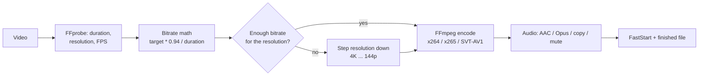

<p align="center">
  <a href="README.md">Русский</a> · <b>English</b>
</p>

# COMPRESS

<p align="center">
  
</p>

<p align="center">
  <a href="https://github.com/lepex1/compress/releases/latest"></a>
  <a href="https://github.com/lepex1/compress/releases"></a>
  
  
  <a href="LICENSE"></a>
</p>

<p align="center">
  <b>Compresses video to a target size without wrecking the picture.</b><br>
  Pick a target weight and resolution — the app derives the bitrate, encodes, and shows progress with an ETA.
</p>

<p align="center">
  <a href="https://github.com/lepex1/shakal">Sibling project: shakal</a>
</p>

<!--
  DEMO SLOT: record assets/demo.gif (~720 px wide, up to 5 MB) and uncomment the block below.
<p align="center">
  
</p>
-->

<!--
  SCREENSHOT: capture the app window, ideally at 2x (around 2000 px wide),
  save it as assets/app.png and uncomment the block below. width = half the file width.
<p align="center">
  
</p>
-->

---

## Features

| Feature | What it gives you |
|---|---|
| **Target size** | A "how many megabytes should come out" slider — bitrate is derived from target size, duration and resolution (94 % of the budget goes to video+audio, 6 % to container overhead) |
| **Three codecs** | H.264 (`libx264`), H.265 (`libx265`), AV1 (`libsvtav1` — presets 2–12 mapped automatically) |
| **Speed presets** | `ultrafast` → `veryslow`; at low bitrates the preset switches to `veryfast` by itself so encoding does not take hours |
| **Resolution & FPS** | From 3840×2160 down to 256×144; the `auto` mode picks a resolution that fits the bitrate budget; FPS from 1 up to the source rate |
| **Audio** | AAC, Opus, stream copy, or strip it entirely; plus volume adjustment −3 … +10 dB |
| **FastStart** | `-movflags +faststart` — video starts playing in a browser before it is fully downloaded |
| **Guard rails** | Sliders never let you exceed the source size, FPS or resolution |
| **FFmpeg bootstrapping** | No binary? It downloads `ffmpeg-master-latest-win64-gpl` from BtbN FFmpeg-Builds (~100 MB) with progress and ETA |
| **Event log** | Colour-coded logs with search and copy — the exact FFmpeg command and the reason for any failure are visible |

**Supported input formats:** `MP4`, `AVI`, `MOV`, `MKV`, `WebM`.

---

## Install

### Option 1 — prebuilt archive (easiest)

1. Open **[Releases](https://github.com/lepex1/compress/releases/latest)**.
2. Download `compress-win-x64.zip` (~12 MB).
3. Unpack anywhere and run `compress.exe`.

No installation required — the Flutter runtime is bundled. FFmpeg is fetched on first launch if missing.

### Option 2 — build from source

```bash
git clone https://github.com/lepex1/compress.git
cd compress
flutter pub get
flutter build windows --release
./build/windows/x64/runner/Release/compress.exe
```

### Option 3 — development run

```bash
flutter pub get
flutter run -d windows
```

**Requirements:** Windows 10/11 x64, Flutter SDK 3.x (options 2–3 only). The UI is Russian-only.

---

## Usage

1. Drop a video into the window (or press **«ВЫБРАТЬ ФАЙЛ»**).
2. Set the **target size** — e.g. 25 MB to fit a Telegram upload limit.
3. Open **«Расширенные настройки»** if needed: codec, speed preset, resolution, FPS, audio, FastStart.
4. Check the output path and hit **«СЖАТЬ ВИДЕО»**.
5. The result lands next to the source with an `_optimized` suffix.

Example: 85 MB, 1280×720 @ 30 FPS → target 25 MB → the app auto-picks `256×144 @ 30 FPS, ~60 kbps, preset veryfast` and shows that plan before it starts.

---

## How it works



The core formula:

```
bitrate = (target_MB * 1024 * 1024 * 8 * 0.94) / duration_s
```

Encoding is single-pass (VBR with `maxrate` = 1.5× and `bufsize` = 2× the target bitrate) — fast, but without two-pass scene analysis.

---

## FAQ

**Why is AV1 so much slower than H.264?**
SVT-AV1 is more size-efficient but noticeably slower on CPU. For a quick result use H.264 + `veryfast`.

**Is there hardware encoding (NVENC / QuickSync)?**
No. Encoding is software-only: `libx264`, `libx265`, `libsvtav1`.

**Can I compress several files at once?**
Not yet — one file at a time.

**The output is bigger than the target size.**
The target is a hint for the video bitrate; with `-c:a copy` the audio is not re-encoded and can add extra megabytes. Use AAC/Opus if you need a precise size.

**The app will not start offline.**
If FFmpeg has not been downloaded yet, an internet connection is required. After the first download it works offline.

---

## License

[MIT](LICENSE).

Uses [FFmpeg](https://ffmpeg.org/) (LGPL/GPL, downloaded separately, not shipped in the archive) and [Flutter](https://flutter.dev/) (BSD-3-Clause).

---

<p align="center">
  Built by <a href="https://lepex.vercel.app/">lepex1</a> · need the opposite — destroy the quality: <a href="https://github.com/lepex1/shakal">shakal</a>
</p>
