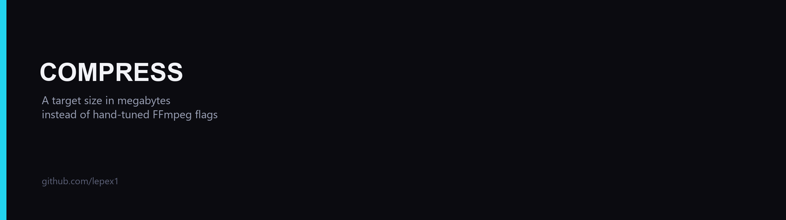
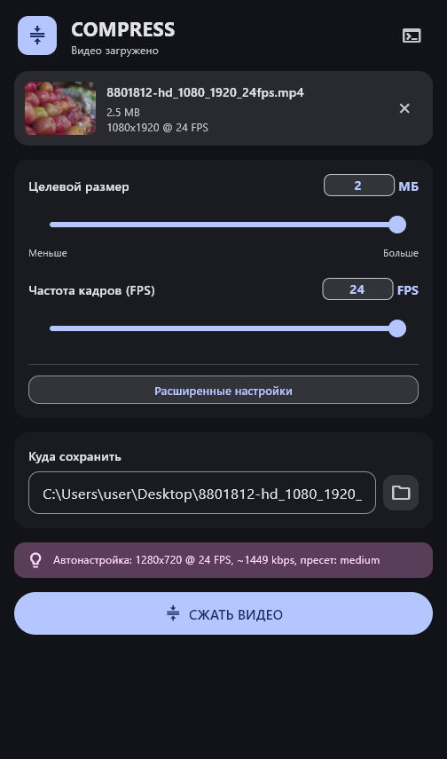
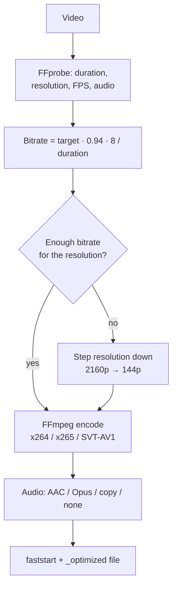

<p align="center">
  <a href="README.md">Русский</a> · <b>English</b>
</p>

# COMPRESS

<p align="center">
  
</p>

<p align="center">
  <a href="https://github.com/lepex1/compress/releases/latest"></a>
  <a href="https://github.com/lepex1/compress/releases"></a>
  
  
  <a href="LICENSE"></a>
</p>

<p align="center">
  <b>Compresses video to the size you ask for without wrecking the picture.<br>
  You set a target weight — it derives the bitrate, picks a resolution and encodes.</b>
</p>

<p align="center">
  <a href="https://github.com/lepex1/shakal">Sibling project: shakal</a>
</p>

## Demo

<!--
  DEMO SLOT: record assets/demo.gif (a real run, up to 5 MB, 880 px wide)
  and uncomment the block below.
<p align="center">
  
</p>
-->

---

## Screenshot

<p align="center">
  
</p>

---

## Why it exists

Phone video weighs 60–200 MB, and you cannot upload it everywhere: Telegram splits files at 2 GB, Discord gives you 10–25 MB, email 20 MB. Re-encoding by hand with `ffmpeg` means computing a bitrate from duration, checking whether it fit, and starting over.

`compress` does that for you:

1. **Reads** the file with FFprobe — duration, resolution, FPS, audio.
2. **Derives** the bitrate from the target weight: 94 % of the budget goes to video and audio, 6 % to container overhead.
3. **Checks** whether that bitrate is enough for the current resolution, and steps the frame down from 2160p to 144p if it is not.
4. **Encodes** to H.264, H.265 or AV1 with live progress; at low bitrates it switches the preset to `veryfast` on its own so encoding does not drag on for hours.
5. **Saves** the result next to the source with an `_optimized` suffix and enables `faststart`, so the file starts playing before it is fully downloaded.

Example: 85 MB, 1280×720 @ 30 FPS, target 25 MB → the app previews `256×144 @ 30 FPS, ~60 kbps, preset veryfast` before it starts.

---

## Compatibility

| Parameter | Value |
|---|---|
| **OS** | Windows 10/11 x64 — tested. macOS and Linux: the Flutter code should build, but has not been tested |
| **Codecs** | H.264 (`libx264`), H.265 (`libx265`), AV1 (`libsvtav1`, presets 2–12 mapped automatically) |
| **Input formats** | MP4, AVI, MOV, MKV, WebM |
| **Resolution and FPS** | 3840×2160 … 256×144, the `auto` mode fits the resolution to the bitrate budget; FPS from 1 up to the source rate |
| **Audio** | AAC, Opus, stream copy, or strip it entirely; volume −3 … +10 dB |
| **Engine** | FFmpeg: the `ffmpeg-master-latest-win64-gpl` build from BtbN FFmpeg-Builds (~100 MB), downloaded automatically when no binary is found |

---

## Quick start (Windows)

1. Download **`compress-win-x64.zip`** from **[Releases](https://github.com/lepex1/compress/releases/latest)** (~12 MB).
2. Unpack it anywhere and run `compress.exe`.
3. Windows will show SmartScreen — normal for an unsigned build: “More info” → “Run anyway”.
4. Drop a video into the window, set the target size and press **«СЖАТЬ ВИДЕО»**.

No installation required — the Flutter runtime is bundled. On first launch the app fetches FFmpeg (~100 MB); after that it works offline.

**Where the result goes:** next to the source file with an `_optimized` suffix, e.g. `C:\video\holiday_optimized.mp4`. The exact path is shown in the “Куда сохранить” box before you start. The UI is Russian-only.

---

## Run from source

```bash
git clone https://github.com/lepex1/compress.git
cd compress
flutter pub get
flutter build windows --release
./build/windows/x64/runner/Release/compress.exe
```

**Requirements:** Flutter SDK 3.x and Visual Studio with “Desktop development with C++” — build only. Running a prebuilt copy needs Windows 10/11 x64.

For development: `flutter run -d windows`.

---

## How compression works



The core formula:

```
bitrate = (target_MB * 1024 * 1024 * 8 * 0.94) / duration_s
```

What sets it apart from “just re-encode”:

- **Resolution follows the budget**, not the other way round: for “25 MB out of 85 MB” the app drops the frame to 256×144 instead of producing a file twice the target.
- **Single-pass VBR** with `maxrate` = 1.5× and `bufsize` = 2× the target bitrate — fast, but without two-pass scene analysis.
- **Sliders never exceed the source**: you cannot pick a size, FPS or resolution above the original.
- **The exact FFmpeg command is visible** in the event log, with search and copy, in case you want to reproduce it by hand.

---

## ⚠️ Read this

- **The target weight is a hint, not a guarantee.** The bitrate is computed for video; audio adds drift: with `copy` the audio is not re-encoded and may add extra megabytes.
- **One file at a time.** There is no batch mode.
- **Software encoding only.** No NVENC/QuickSync: `libx264`, `libx265`, `libsvtav1`.
- **AV1 is slow on CPU.** SVT-AV1 produces smaller files but takes several times longer than H.264.
- **The first launch needs internet** until FFmpeg is downloaded. Everything after that works offline.

---

## FAQ

**SmartScreen/antivirus flags the `.exe`.**
That happens with every unsigned build (a code-signing certificate costs money). You can skip the archive and build from source — the code is open.

**The output is bigger than the target size.**
Most likely the audio is set to `copy` and keeps its original bitrate. Switch to AAC or Opus for a tighter target.

**Is there hardware encoding (NVENC / QuickSync)?**
No. Encoding is software-only.

**Can I compress several files at once?**
Not yet — one file at a time.

**The app does not start offline.**
Only if FFmpeg has not been downloaded yet. After the first fetch it sits next to the app and is used locally.

---

## License

[MIT](LICENSE) — use it, fork it, change it.

This project is **not affiliated** with FFmpeg or its build providers. The list of third-party components and their licenses is in [THIRD-PARTY-NOTICES.md](THIRD-PARTY-NOTICES.md): FFmpeg (LGPL-2.1+ / GPL-2.0+ for the `gpl` build), BtbN FFmpeg-Builds, Flutter and pub.dev packages.

---

<p align="center">
  Built by <a href="https://lepex.vercel.app/">lepex1</a>
</p>
