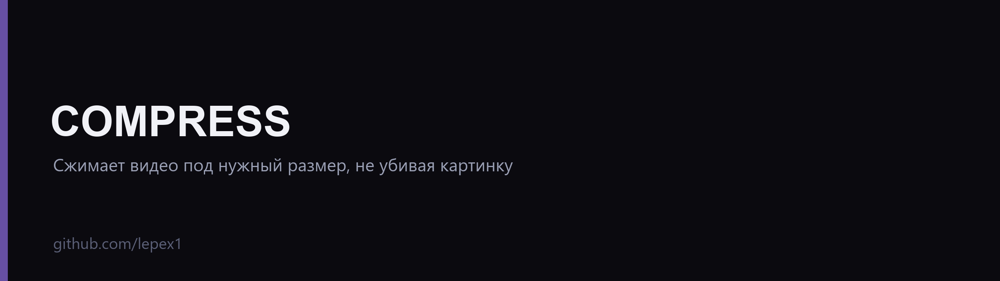
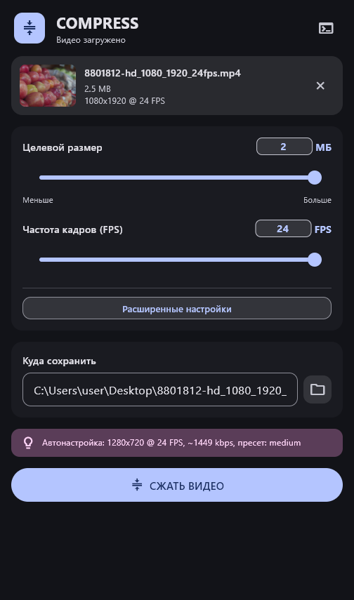
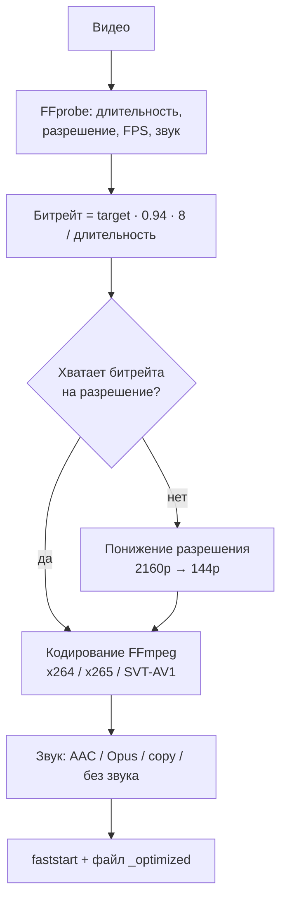

<p align="center">
  <b>Русский</b> · <a href="README.en.md">English</a>
</p>

# COMPRESS

<p align="center">
  
</p>

<p align="center">
  <a href="https://github.com/lepex1/compress/releases/latest"></a>
  <a href="https://github.com/lepex1/compress/releases"></a>
  
  
  <a href="LICENSE"></a>
</p>

<p align="center">
  <b>Сжимает видео под нужный размер, не убивая картинку.<br>
  Задаёшь целевой вес — программа считает битрейт, подбирает разрешение и кодирует.</b>
</p>

<p align="center">
  <a href="https://github.com/lepex1/shakal">Соседний проект: shakal</a>
</p>

## Демонстрация

<!--
  ДЕМО-СЛОТ: записать assets/demo.gif (реальный запуск, до 5 МБ, ширина 880 px)
  и раскомментировать блок ниже.
<p align="center">
  
</p>
-->

---

## Скриншот

<p align="center">
  
</p>

---

## Зачем это нужно

Видео с телефона весит 60–200 МБ, а залить его можно не везде: Telegram режет файлы на 2 ГБ, Discord даёт 10–25 МБ, почта — 20 МБ. Пережать вручную через `ffmpeg` — это считать битрейт под длительность, проверять, влезло ли, и повторять заново.

`compress` делает это за вас:

1. **Читает** файл через FFprobe — длительность, разрешение, FPS, звук.
2. **Считает** битрейт из целевого веса: 94 % бюджета уходит на видео и звук, 6 % — на контейнер.
3. **Проверяет**, хватает ли этого битрейта на текущее разрешение, и если нет — спускает разрешение по лестнице от 2160p к 144p.
4. **Кодирует** в H.264, H.265 или AV1, показывая прогресс; при низком битрейте сам переключает пресет на `veryfast`, чтобы кодирование не растянулось на часы.
5. **Сохраняет** результат рядом с исходником с суффиксом `_optimized` и включает `faststart`, чтобы файл начинал играть до полной загрузки.

Пример: 85 МБ, 1280×720 @ 30 FPS, цель 25 МБ → программа показывает план `256×144 @ 30 FPS, ~60 kbps, preset veryfast` ещё до старта.

---

## Совместимость

| Параметр | Значение |
|---|---|
| **ОС** | Windows 10/11 x64 — протестировано. macOS и Linux: код на Flutter в теории собирается, но не проверялся |
| **Кодеки** | H.264 (`libx264`), H.265 (`libx265`), AV1 (`libsvtav1`, пресеты 2–12 подбираются автоматически) |
| **Форматы входа** | MP4, AVI, MOV, MKV, WebM |
| **Разрешение и FPS** | 3840×2160 … 256×144, режим `auto` подбирает разрешение под битрейт; FPS от 1 до исходного |
| **Звук** | AAC, Opus, копирование как есть или полное удаление; громкость −3 … +10 дБ |
| **Движок** | FFmpeg: сборка `ffmpeg-master-latest-win64-gpl` с BtbN FFmpeg-Builds (~100 МБ), скачивается автоматически, если бинарника нет рядом |

---

## Быстрый старт (Windows)

1. Скачай **`compress-win-x64.zip`** со страницы **[Releases](https://github.com/lepex1/compress/releases/latest)** (≈12 МБ).
2. Распакуй в любую папку и запусти `compress.exe`.
3. Windows покажет SmartScreen — это обычное поведение для неподписанной сборки: «Подробнее» → «Выполнить в любом случае».
4. Перетащи видео в окно, выставь целевой размер и жми **«СЖАТЬ ВИДЕО»**.

Установка не нужна: рантайм Flutter уже внутри. При первом запуске программа докачает FFmpeg (~100 МБ), дальше работает офлайн.

**Где результат:** рядом с исходным файлом, с суффиксом `_optimized` — например `C:\video\отпуск_optimized.mp4`. Точный путь показан в блоке «Куда сохранить» до старта.

---

## Запуск из исходного кода

```bash
git clone https://github.com/lepex1/compress.git
cd compress
flutter pub get
flutter build windows --release
./build/windows/x64/runner/Release/compress.exe
```

**Требования:** Flutter SDK 3.x и Visual Studio с «Desktop development with C++» — только для сборки. Для запуска готовой сборки нужен Windows 10/11 x64.

Для разработки: `flutter run -d windows`.

---

## Как работает компрессия



Ключевая формула:

```
bitrate = (target_MB * 1024 * 1024 * 8 * 0.94) / duration_s
```

Чем это отличается от «просто пережать»:

- **Разрешение подстраивается под бюджет**, а не наоборот: при цели «25 МБ из 85 МБ» программа опускает кадр до 256×144, а не выдаёт файл вдвое больше цели.
- **Однопроходный VBR** с `maxrate` = 1.5× и `bufsize` = 2× от целевого битрейта — быстро, но без двухпроходного анализа сцен.
- **Ползунки не дают выйти за пределы исходника**: размер больше исходного, FPS выше исходного и разрешение выше исходного выставить нельзя.
- **Видно точную команду FFmpeg** в журнале событий — с поиском и копированием, если захочется повторить руками.

---

## ⚠️ Важно понимать

- **Целевой вес — ориентир, а не гарантия.** Битрейт считается под видео, погрешность даёт звук: при копировании аудио (`copy`) оно не пережимается и может добавить лишние мегабайты.
- **Один файл за раз.** Пакетной обработки нет.
- **Только программное кодирование.** NVENC/QuickSync не используются: `libx264`, `libx265`, `libsvtav1`.
- **AV1 на CPU медленный.** SVT-AV1 даёт меньший файл, но кодирование длится кратно дольше H.264.
- **Первый запуск требует интернета**, пока FFmpeg не скачан. Дальше программа работает офлайн.

---

## Частые вопросы

**SmartScreen/антивирус ругается на `.exe`.**
Так бывает со всеми неподписанными сборками (сертификат подписи стоит денег). Можно не доверять архиву и собрать из исходников — код открыт.

**Файл получился больше целевого размера.**
Скорее всего, звук стоит на `copy` и тянет за собой исходный битрейт. Поставь AAC или Opus — тогда цель держится точнее.

**Есть аппаратное кодирование (NVENC / QuickSync)?**
Нет. Кодирование только программное.

**Можно ли сжать сразу несколько файлов?**
Пока нет — один файл за раз.

**Программа не стартует без интернета.**
Если FFmpeg ещё не скачан — да. После первой загрузки он лежит рядом с программой и нужен только локально.

---

## Лицензия

[MIT](LICENSE) — используй, форкай, меняй.

Проект **не связан** с FFmpeg и его сборщиками. Список сторонних компонентов и их лицензий — в [THIRD-PARTY-NOTICES.md](THIRD-PARTY-NOTICES.md): FFmpeg (LGPL-2.1+ / GPL-2.0+ для сборки `gpl`), BtbN FFmpeg-Builds, Flutter и пакеты pub.dev.

---

<p align="center">
  Сделал <a href="https://lepex.vercel.app/">lepex1</a>
</p>
