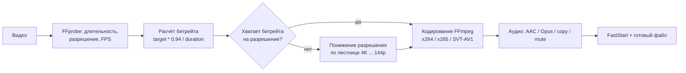

<p align="center">
  <b>Русский</b> · <a href="README.en.md">English</a>
</p>

# COMPRESS

<p align="center">
  
</p>

<p align="center">
  <a href="https://github.com/lepex1/compress/releases/latest"></a>
  <a href="https://github.com/lepex1/compress/releases"></a>
  
  
  <a href="LICENSE"></a>
</p>

<p align="center">
  <b>Сжимает видео под нужный размер, не убивая картинку.</b><br>
  Задаёшь целевой вес и разрешение — программа сама считает битрейт, кодирует и показывает прогресс.
</p>

<p align="center">
  <a href="https://github.com/lepex1/shakal">Соседний проект: shakal</a>
</p>

<!--
  ДЕМО-СЛОТ: записать assets/demo.gif (ширина ~720 px, до 5 МБ) и раскомментировать блок ниже.
<p align="center">
  
</p>
-->

<!--
  СКРИНШОТ: снять окно программы, лучше сразу в 2× (например, 2000 px по ширине),
  положить в assets/app.png и раскомментировать блок ниже. width — половина ширины файла.
<p align="center">
  
</p>
-->

---

## Возможности

| Возможность | Что даёт |
|---|---|
| **Целевой вес** | Ползунок «сколько должно получиться в мегабайтах» — битрейт считается из целевого размера, длительности и разрешения (94 % бюджета уходит на видео+звук, 6 % — на контейнер) |
| **Три кодека** | H.264 (`libx264`), H.265 (`libx265`), AV1 (`libsvtav1` — пресеты 2–12 подбираются автоматически) |
| **Пресеты скорости** | `ultrafast` → `veryslow`; при низком битрейте пресет сам переключается на `veryfast`, чтобы кодирование не растягивалось на часы |
| **Разрешение и FPS** | От 3840×2160 до 256×144, режим `auto` подбирает разрешение под бюджет битрейта; FPS — от 1 кадра/с до исходного |
| **Звук** | AAC, Opus, копирование как есть или полное удаление; плюс регулировка громкости −3 … +10 дБ |
| **FastStart** | `-movflags +faststart` — видео начинает играть в браузере до полной загрузки |
| **Защита от лишнего** | Ползунки не дают выставить размер больше исходного, FPS выше исходного и разрешение выше исходного |
| **FFmpeg сам подтягивается** | Нет бинарника — скачает `ffmpeg-master-latest-win64-gpl` с BtbN FFmpeg-Builds (~100 МБ) с прогрессом и ETA |
| **Журнал событий** | Цветные логи с поиском и копированием — видно точную команду FFmpeg и причину любой ошибки |

**Поддерживаемые форматы входа:** `MP4`, `AVI`, `MOV`, `MKV`, `WebM`.

---

## Установка

### Вариант 1 — готовый архив (проще всего)

1. Открой **[Releases](https://github.com/lepex1/compress/releases/latest)**.
2. Скачай `compress-win-x64.zip` (≈12 МБ).
3. Распакуй в любую папку и запусти `compress.exe`.

Установка не нужна: рантайм Flutter уже внутри. FFmpeg докачается при первом запуске, если его нет рядом.

### Вариант 2 — сборка из исходников

```bash
git clone https://github.com/lepex1/compress.git
cd compress
flutter pub get
flutter build windows --release
./build/windows/x64/runner/Release/compress.exe
```

### Вариант 3 — запуск для разработки

```bash
flutter pub get
flutter run -d windows
```

**Требования:** Windows 10/11 x64, Flutter SDK 3.x (только для вариантов 2–3).

---

## Как пользоваться

1. Перетащи видео в окно (или нажми **«Выбрать файл»**).
2. Выстави **целевой размер** — например, 25 МБ, чтобы влезло в лимит Telegram.
3. При необходимости открой **«Расширенные настройки»**: кодек, пресет скорости, разрешение, FPS, звук, FastStart.
4. Проверь путь сохранения и жми **«СЖАТЬ ВИДЕО»**.
5. Результат появится с суффиксом `_optimized` рядом с исходником.

Пример: 85 МБ, 1280×720 @ 30 FPS → цель 25 МБ → автонастройка `256×144 @ 30 FPS, ~60 kbps, preset veryfast` (так программа показывает свой план до старта).

---

## Как это работает



Ключевая формула:

```
bitrate = (target_MB * 1024 * 1024 * 8 * 0.94) / duration_s
```

Кодирование однопроходное (VBR с `maxrate` = 1.5× и `bufsize` = 2× от целевого битрейта) — быстро, но без двухпроходного анализа сцен.

---

## Частые вопросы

**Почему AV1 кодируется в разы дольше H.264?**
SVT-AV1 эффективнее по размеру, но заметно медленнее на CPU. Для быстрого результата бери H.264 + `veryfast`.

**Есть аппаратное кодирование (NVENC / QuickSync)?**
Нет. Кодирование программное: `libx264`, `libx265`, `libsvtav1`.

**Можно ли сжать сразу несколько файлов?**
Пока нет — один файл за раз.

**Файл получился больше целевого размера.**
Целевой вес — это ориентир для видеобитрейта; при `-c:a copy` звук не пережимается и может добавить лишние мегабайты. Поставь AAC/Opus, если нужен точный размер.

**Программа не стартует без интернета.**
Если FFmpeg ещё не скачан — да, нужен интернет. После первой загрузки работает офлайн.

---

## Лицензия

[MIT](LICENSE).

Используется [FFmpeg](https://ffmpeg.org/) (LGPL/GPL, скачивается отдельно, в архив не входит) и [Flutter](https://flutter.dev/) (BSD-3-Clause).

---

<p align="center">
  Сделал <a href="https://lepex.vercel.app/">lepex1</a> · если наоборот надо убить качество — <a href="https://github.com/lepex1/shakal">shakal</a>
</p>
